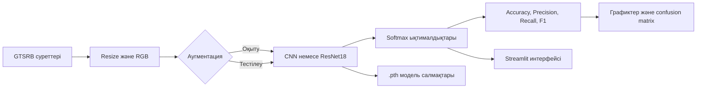

# Терең оқытуға негізделген жол белгілерін тану жүйесі

## 1. Кіріспе

Жол қозғалысы қауіптілігіне ықпал ететін факторлардың бірі — жүргізушінің жол белгілерін дұрыс әрі дер кезінде түсінбеуі. Терең оқыту негізіндегі классификация жүйесі суреттегі белгіні автоматты түрде анықтап, жүргізушіге көмекші кеңес бере алады. Бұл курстық жұмыстың мақсаты — GTSRB деректер жиынын пайдаланып 43 жол белгісі сыныбын танитын PyTorch жүйесін әзірлеу және CNN мен ResNet18 нәтижелерін нақты эксперимент арқылы салыстыру.

### Зерттеу міндеттері

1. GTSRB деректерінің құрылымын талдау және алдын ала өңдеу.
2. Нөлден үйретілетін өзіндік CNN архитектурасын құру.
3. ResNet18 моделін 43 шығыс сыныбына адаптациялау.
4. Модельдерді оқыту, ең жақсы салмақтарды сақтау және тестілеу.
5. Accuracy, weighted Precision, weighted Recall, F1-score және confusion matrix есептеу.
6. Streamlit интерфейсі арқылы жекелей, камера және пакеттік тануды жүзеге асыру.
7. Нәтижелерді графиктермен және кестелермен ғылыми түрде ұсыну.

## 2. Теориялық бөлім

### Терең оқыту және CNN

Классикалық CNN суреттен convulsion ядролары арқылы локалды сипаттамаларды шығарады. Conv2D қабаты кеңістіктік белгілерді, Batch Normalization үйренуді тұрақтандырады, ReLU сызықты емес қасиет береді, ал Max Pooling кеңістіктік өлшемді азайтып маңызды ерекшелікті сақтайды. Dropout оқыту барысында кейбір нейрондарды кездейсоқ өшіріп, артық үлгілеуді азайтуды мақсат етеді.

Softmax шығыс қабаты әр сыныпқа сенімділік үлесін береді:

$$p(y=i|x)=\frac{e^{z_i}}{\sum_{j=1}^{43}e^{z_j}}$$

### Transfer Learning және ResNet18

ResNet18 қалдық байланыстар арқылы терең желінің градиент ағынын сақтайды. Бұл жұмыста Residue Learning Transfer әдісінің екі нұсқасы қарастырылған: бастапқы Random parameters және ImageNet салмақтарын `--pretrained` опциясымен жүктеу арқылы transfer learning. Соңғы 1000 сыныпты шығаратын `fc` қабаты GTSRB-ға 43 сыныптан тұратын сызықтық қабатпен ауыстырылады.

## 3. GTSRB деректер жиыны

German Traffic Sign Recognition Benchmark келесі форматта ұсынылады:

```text
data/raw/GTSRB/
├── Train/
│   ├── 0/
│   ├── 1/
│   └── .../42/
├── Test/
├── Test.csv
└── Meta/
```

Жүйе оқыту деректерін `Train/<class_id>/` папкаларынан оқиды. Оқытуды үйрену және бақылау үшін сыныптар пропорциясын сақтайтын train/validation бөлінуі қолданылады. Тест дерегі `Test.csv` арқылы нақты жолы мен `ClassId` өрісімен жүктеледі.

## 4. Жүйе архитектурасы



Жүйе екі деңгейге бөлінген: модельдің оқыту/бағалау блогы және Streamlit пайдаланушы интерфейсі. Бұл модульдік құрылым модельдердің ауыстырылуын, тестілеуді және интерфейсті бөлек тексеруді жеңілдетеді.

## 5. Бағдарламаның құрылымы

```text
src/dataset.py       GTSRB жүктеу және бөліну
src/preprocessing.py Resize, аугментация, нормализация
src/model.py         Custom CNN және ResNet18
src/metrics.py       Метрикалар және графиктер
src/utils.py         Seed, device, checkpoint
train.py             Екі модельді оқыту
 evaluate.py          Тесттік бағалау
predict.py           Бір сурет және пакеттік болжау
app.py               Streamlit интерфейсі
compare_models.py    Нақты модельдердің салыстырмалы кестесі
```

## 6. Алдын ала өңдеу және аугментация

Барлық сурет 64×64 пикселге масштабталады және RGB форматында беріледі. PyTorch Tensor түріне ауыстырылғаннан кейін ImageNet орта мәні мен стандарттық ауытқуы қолданылады:

- mean: 0.485, 0.456, 0.406
- std: 0.229, 0.224, 0.225

Оқыту деректеріне ±10 градусқа айналдыру, жарықтық және контраст өзгерісі беріледі. Горизонталды айналдыру қолданылмайды, себебі жол белгілерінің геометриялық бағыты мағынасына әсер етуі мүмкін.

## 7. Модель архитектуралары

### Custom CNN

Custom CNN үш конволюциялық блоктан, Batch Normalization және Dropout қабаттарынан тұрады. Feature map-таршыгығы төмендетілгеннен кейін AdaptiveAvgPool2d өлшемін 1×1-ге келтіреді, содан кейін сызықтық классификатор 43 шығыс жасайды.

### ResNet18

`torchvision.models.resnet18` базалық желісі пайдаланылады. Соңғы Fully Connected қабат 43 сыныпқа ауыстырылады. Иә, екі режим бар: `pretrained=False` Random Learning және `--pretrained` нұсқасы ImageNet Transfer Learning.

## 8. Модельді оқыту

Модельдерді оқыту командасы:

```bash
python train.py --model cnn --epochs 20
python train.py --model resnet18 --epochs 20 --pretrained
```

Оқыту параметрлері:

- Optimizer: AdamW;
- Loss: Cross Entropy;
- Default learning rate: 0.001;
- Weight decay: 0.0001;
- Шағын партия: 64;
- Seed: 42;
- Ең жақсы validation accuracy мәні сақталады.

`ReduceLROnPlateau` validation accuracy 2 эпоха бойы жақсармайынша learning rate-ті азайтады.

## 9. Эксперименттік бағалау

Модельдер сынақ деректерінде жеке бағаланады:

```bash
python evaluate.py --model cnn --data-dir data/raw/GTSRB
python evaluate.py --model resnet18 --data-dir data/raw/GTSRB
python compare_models.py
```

Бағалау кезінде шынайы test predictions алынады. Нәтижелер:

- `results/cnn/metrics.json`;
- `results/resnet18/metrics.json`;
- `confusion_matrix.png`;
- `accuracy.png`;
- `loss.png`;
- `classification_report.json`;
- `model_comparison.csv` және `model_comparison.md`.

## 10. Сапа метрикалары

Accuracy барлық дұрыс нәтижелердің үлесі:

$$Accuracy=\frac{TP+TN}{TP+TN+FP+FN}$$

Weighted Precision барлық сыныптар бойынша precision мәнін сынып үлесі бойынша орташа есеппен бағалайды. Weighted Recall және weighted F1-score сол принциппен есептеледі.

Нақты эксперимент жүргізілгенге дейін нақты нәтижелер жоқ. Бұл жүйе accuracy мәнін немесе графиктерді ойдан шығармайды. Егер GTSRB және checkpoints жоқ болса, evaluate.py тестті бастамастан checkpoint жеткіліксіздігі туралы қатені шығарады.

## 11. Streamlit интерфейсі

Интерфейс келесі бөлімдерден тұрады:

- Home — жүйе және модельдер туралы ақпарат;
- Recognition — бір суретті жүктеп тану;
- Webcam — камерадан сурет алу;
- Batch Recognition — бірнеше суретті бірге өңдеу;
- Model Performance — тек шынайы evaluation артефактілері;
- About Project — технологиялар және деректер жиыны.

Интерфейсті іске қосу:

```bash
streamlit run app.py
```

## 12. Бағдарламаны тексеру

```bash
pytest -q
```

Базалық тесттер custom CNN және ResNet18 шығыс өлшемін, 64×64 preprocessing түрлендіруін және жоқ checkpoint жағдайын тексереді.

## 13. Қорытынды

Жоба GTSRB деректеріне негізделген PyTorch CNN және ResNet18 классификациялық жүйесін қамтамасыз етеді. Бағдарлама сурет жүктеу, камера және пакеттік тану мүмкіндіктерімен шығыс береді. Нақты scientific quality метрикалар тек әдейі датасетте және нақты checkpoint-пен орындалған run нәтижесінде қалыптасады.

Екі модельді салыстыруға кастом CNN және transfer learning/ResNet18 қосылған. Болашақта YOLO сияқты объект detection тәсілімен бүкіл жол көрінісіндегі белгілерді анықтау және мобилге оңтайландыру мүмкін.

## 14. Әдебиеттер

1. Stallkamp J., Schlipsing M., Salmen J., Igel C. The German Traffic Sign Recognition Benchmark: a multi-class classification competition. — IJCNN, 2011.
2. He K., Zhang X., Ren S., Sun J. Deep Residual Learning for Image Recognition. — CVPR, 2016.
3. Goodfellow I., Bengio Y., Courville A. Deep Learning. — MIT Press, 2016.
4. PyTorch Documentation — https://pytorch.org/docs/
5. torchvision Documentation — https://pytorch.org/vision/stable/
6. Streamlit Documentation — https://docs.streamlit.io/
7. Scikit-learn Documentation — https://scikit-learn.org/stable/
